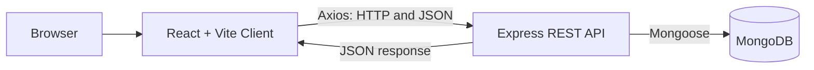
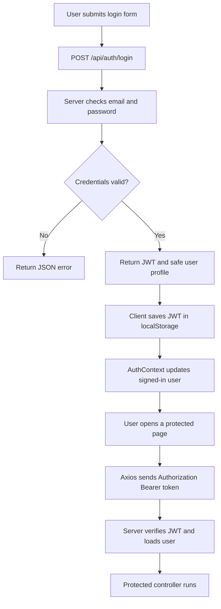
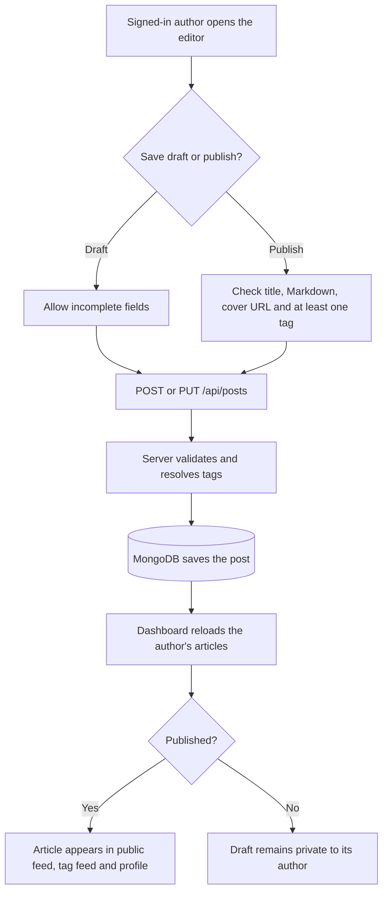
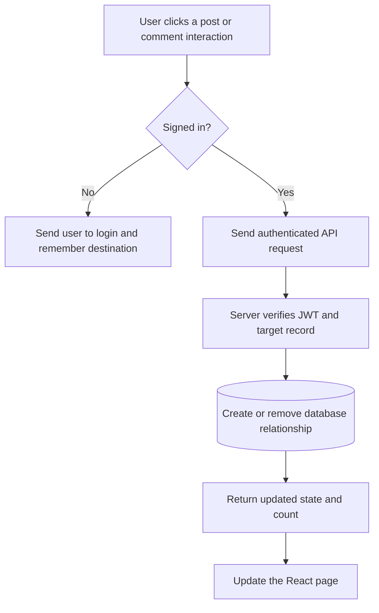
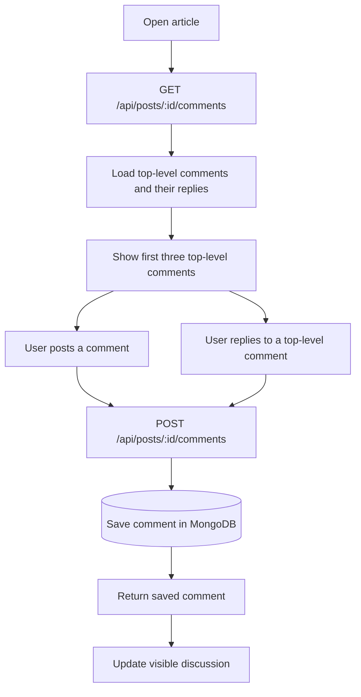

# Hashnode Clone

A developer-focused blogging and publishing platform inspired by Hashnode. This is an independent educational MERN project; it is not affiliated with or endorsed by Hashnode.

The repository contains the original React/Vite frontend, an Express/MongoDB REST API, and the Phase 3 integration that connects them. The goal of Phase 3 is to keep the existing design and make the user workflows work with real database data.

## Project status

| Phase | Scope | Status |
|---|---|---|
| Phase 1 | Responsive React frontend and its design system | Completed |
| Phase 2 | Express API, MongoDB models, JWT authentication, authorization and API tests | Completed |
| Phase 3 | Connect the frontend to the API and replace mock repositories | Completed; local integration workflows verified |
| Phase 4 | Broader quality checks, production hardening and deployment | In progress |

**Phase 2 backend verification:** the supplied Postman run completed 54 requests with 79 assertions passing. The server Node.js test suite contains 13 tests. Phase 3 browser testing must still be carried out with your own running MongoDB and API; this ZIP has not been tested against your local database.

## Contents

- [Features](#features)
- [Technology](#technology)
- [Architecture](#architecture)
- [Beginner-friendly code guide](CODE-STYLE.md)
- [Project structure](#project-structure)
- [Getting started](#getting-started)
- [How the application works](#how-the-application-works)
- [API overview](#api-overview)
- [Testing checklist](#testing-checklist)
- [Security notes](#security-notes)
- [Troubleshooting](#troubleshooting)
- [Roadmap](#roadmap)

## Features

### Public browsing

- Home page with a hero section, featured articles, topic links and a Latest Posts section with in-place article-title search.
- Public feed with title search, topic filtering, newest/oldest sorting and server-side pagination.
- Homepage Latest Posts search: type a title keyword and matching published articles appear automatically in the same section after a short pause. There is no Search button. Clear restores the normal nine newest articles; View all matching posts opens the full Feed with the same search term.
- Topic directory and topic-specific article feeds.
- Article details with Markdown rendering and syntax-highlighted code blocks.
- Public author profiles with published articles and follower/following counts.

### Accounts and publishing

- Registration and login using real API endpoints.
- JWT session restoration after refreshing the browser.
- Logout and protected frontend routes.
- Dashboard with the signed-in user's own published posts and drafts.
- Create incomplete drafts, edit drafts, publish articles, edit published articles and delete owned articles.
- Persistent profile settings for display name and bio, with Cloudinary avatar image uploads.

### Community interactions

- Persistent post likes and bookmarks.
- Saved-articles page.
- Persistent follow/unfollow relationships.
- Comments, one-level replies, comment likes, and owner-only comment editing/deletion.
- Initial display of three top-level comments with a Load More interaction.

## Technology

| Area | Technology |
|---|---|
| Frontend | React, Vite, JavaScript, React Router, Axios |
| Styling | Existing CSS design tokens, responsive styles, light/dark themes |
| Markdown | react-markdown and react-syntax-highlighter |
| Backend | Node.js, Express 5, JavaScript ES modules |
| Database | MongoDB and Mongoose |
| Authentication | jsonwebtoken and bcryptjs |
| Testing | Postman and Node.js built-in test runner |

The project uses plain JavaScript. TypeScript, Redux and server-side rendering are not used.

## Architecture

The browser communicates with the Express REST API using Axios. The API checks requests, verifies authentication and ownership, accesses MongoDB through Mongoose, and returns JSON. The React application never connects directly to MongoDB.



### Authentication request flow



When the app starts, `AuthContext` checks for a saved token and calls `GET /api/auth/me`. A valid token restores the session. An invalid or expired token is removed and the visitor is treated as a guest.

### Create and publish article flow



### Social interaction flow



### Comment and reply flow



## Project structure

```text
hasnode-clone/
├── client/
│   ├── public/
│   ├── src/
│   │   ├── api/                 # Axios setup and small API request modules
│   │   ├── components/          # Shared UI, layout and post components
│   │   ├── context/             # AuthContext and ThemeContext
│   │   ├── hooks/               # useAuth and useTheme
│   │   ├── pages/               # Home, feed, editor, dashboard, profiles, etc.
│   │   ├── styles/              # Existing design system and responsive CSS
│   │   └── utils/               # Small frontend helpers
│   ├── .env.example
│   ├── package.json
│   └── package-lock.json
│
├── server/
│   ├── config/                  # MongoDB connection
│   ├── controllers/             # API request handlers
│   ├── middleware/              # JWT, validation and error handling
│   ├── models/                  # Mongoose models
│   ├── postman/                 # Phase 2 Postman collection
│   ├── routes/                  # Express route definitions
│   ├── scripts/                 # Syntax-check script
│   ├── tests/                   # Backend utility tests
│   ├── utils/                   # Slugs, content and response helpers
│   ├── .env.example
│   ├── API.md
│   ├── package.json
│   └── server.js
│
├── .gitignore
└── README.md
```

Old mock repositories and mock user/post/comment data were retired during Phase 3. The regular application pages now request their data from the backend. The browser still uses localStorage for the JWT, theme preference and the separate editor-preview handoff; article, profile and interaction records are stored in MongoDB.

## Getting started

### Prerequisites

- Node.js **20.19.0 or newer** and npm.
- MongoDB Community Server running locally, or a MongoDB Atlas database.
- VS Code and Postman are recommended.

### 1. Install frontend packages

Open a terminal in the project root:

```bash
cd client
npm install
```

### 2. Install backend packages

Open a second terminal at the project root:

```bash
cd server
npm install
```

### 3. Configure the backend

In the `server` directory, make a local environment file from the example.

**Windows PowerShell:**

```powershell
Copy-Item .env.example .env
```

**macOS / Linux:**

```bash
cp .env.example .env
```

Set the required values in `server/.env`:

```env
PORT=5000
NODE_ENV=development
MONGODB_URI=mongodb://127.0.0.1:27017/hashnode_clone
JWT_SECRET=replace_with_a_private_random_secret
JWT_EXPIRES_IN=1d
CLIENT_URL=http://localhost:5173
JSON_BODY_LIMIT=2mb
BCRYPT_SALT_ROUNDS=12
```

Generate a private JWT secret with Node.js:

```bash
node -e "console.log(require('crypto').randomBytes(64).toString('hex'))"
```

Keep the real secret only in your local `.env`. Never commit it or share it in screenshots.

### 4. Configure the frontend

In the `client` directory:

**Windows PowerShell:**

```powershell
Copy-Item .env.example .env
```

**macOS / Linux:**

```bash
cp .env.example .env
```

The local setting should be:

```env
VITE_API_BASE_URL=http://localhost:5000/api
```

### 5. Start MongoDB and the backend

Make sure MongoDB is running. In the backend terminal:

```bash
cd server
npm run dev
```

Confirm the API is ready at `http://localhost:5000/api/health`. A healthy response reports `success: true` and `database: "connected"`.

### 6. Start the frontend

In a third terminal:

```bash
cd client
npm run dev
```

Open the Vite address shown in the terminal, normally `http://localhost:5173`.

## How the application works

### API communication

All API calls are grouped in small files under `client/src/api/`:

| File | Purpose |
|---|---|
| `axios.js` | API base URL, timeout, Bearer token and common error handling |
| `authApi.js` | Registration, login and current-user lookup |
| `postsApi.js` | Public feed, article detail, dashboard and editor requests |
| `tagsApi.js` | Topic list, topic feed and tag creation/reuse |
| `usersApi.js` | Public profile, profile updates, follow and bookmarks |
| `commentsApi.js` | Comments, replies, edits, deletions and comment likes |
| `interactionsApi.js` | Post likes and bookmarks |

The backend returns a success envelope: `{ "success": true, "data": ... }`. The API modules extract `data` and pagination details so pages do not need to repeat that response-handling code.

### Authentication state

`AuthContext.jsx` stores the signed-in user, token and a simple status: `loading`, `authenticated` or `guest`. Pages access it through `useAuth()`. The `ProtectedRoute` component checks the status before showing the dashboard, editor, settings and bookmarks page.

The Axios request interceptor adds the saved token as `Authorization: Bearer <token>`. The server still checks all protected actions and ownership; hiding a button in React is not treated as security.

### Useful development rules

- Keep page-specific inputs and loading/error state in the page that owns them.
- Put HTTP requests in the existing API modules instead of calling Axios directly from every page.
- Keep the existing CSS and components unless a real integration requirement needs a change.
- Do not add user IDs or author IDs to post requests; the server derives the signed-in user from the JWT.
- Do not put secrets in `client/.env`; Vite variables are visible to the browser. The frontend only needs the API base URL.

## Optional local demo data

For a populated local test database, the project includes a repeatable development seeder. It creates three clearly named demo users, nine topics, twelve articles (ten published and two drafts), comments, replies and social interactions.

Run this only against your local development database:

```bash
cd server
npm run seed
```

All three demo users use the local-only password `DemoPass@123`:

- `demo.ashish@hasnode.local`
- `demo.priya@hasnode.local`
- `demo.rahul@hasnode.local`

The script reuses its own demo records when run again and does not delete unrelated records. Do not use these sample accounts in production.

## Homepage Latest Posts search

The homepage search lives beside the **Latest Posts** heading. It searches the title of every published article through the existing `GET /api/posts?search=...` endpoint.

- Search starts automatically after the user pauses typing for about 350 milliseconds.
- The browser does not send a request for every individual keystroke.
- The homepage shows at most nine matching article cards, keeping the section the same size as its normal latest-posts view.
- Clearing the search loads the nine newest published articles again.
- The total matching article count is still returned by the API. The **View all matching posts** link opens the full paginated Feed with the same search term.
- Search matches post titles, as required by the original PRD. It does not search the full Markdown body.

This uses a small React effect and a timer. The timer is cleared when the user types again, so only the latest input is searched.

## Image uploads with Cloudinary

Profile photos and article cover images are uploaded to Cloudinary. The browser first requests a short-lived upload signature from the authenticated API, then sends the selected image directly to Cloudinary. The Cloudinary API secret stays in the backend environment and is never sent to the browser.

1. Create a Cloudinary account and open the API Keys page in the Cloudinary Console.
2. Copy the Cloud name, API Key and API Secret into `server/.env`:

```env
CLOUDINARY_CLOUD_NAME=your_cloud_name
CLOUDINARY_API_KEY=your_api_key
CLOUDINARY_API_SECRET=your_api_secret
```

3. Restart the backend after saving the environment file.
4. In Settings, choose a profile image. In the article editor, choose a cover image. JPG, PNG, WEBP and GIF are supported up to 5 MB.
5. Save Settings after the avatar upload finishes. An article cover is attached to the article when you save the draft or publish it.

Keep the API Secret private. Do not add it to `client/.env`, commit it to Git, or share it in screenshots. If Cloudinary is not configured, the application still runs, but image uploads return a clear configuration error.

## API overview

Base URL: `http://localhost:5000/api`. For protected endpoints the client sends `Authorization: Bearer <JWT>` automatically after login.

| Area | Method and endpoint | Purpose |
|---|---|---|
| Auth | `POST /auth/register` | Create a user account |
| Auth | `POST /auth/login` | Log in and receive a JWT |
| Auth | `GET /auth/me` | Restore the current session |
| Posts | `GET /posts` | Published feed, search, sort, tag and pagination |
| Posts | `GET /posts/featured` | Featured published posts |
| Posts | `GET /posts/:slug` | Published article detail |
| Posts | `POST /posts` | Create a draft or publish an article |
| Posts | `GET /posts/mine` | List the signed-in user's posts |
| Posts | `GET /posts/mine/:id` | Load an owned article for editing |
| Posts | `PUT /posts/:id` | Update an owned article |
| Posts | `DELETE /posts/:id` | Delete an owned article |
| Tags | `GET /tags` | List topics and published post counts |
| Tags | `GET /tags/:slug/posts` | Browse posts for a topic |
| Tags | `POST /tags` | Create or reuse a topic |
| Users | `GET /users/:id` | Public profile by MongoDB ID or username |
| Users | `PUT /users/me` | Update the signed-in user's profile |
| Users | `PUT /users/:id/follow` | Follow an author |
| Users | `DELETE /users/:id/follow` | Unfollow an author |
| Users | `GET /users/me/bookmarks` | List saved articles |
| Users | `GET /users/me/followers` | List followers |
| Users | `GET /users/me/following` | List followed authors |
| Post interactions | `PUT/DELETE /posts/:id/like` | Like or unlike a post |
| Post interactions | `PUT/DELETE /posts/:id/bookmark` | Save or remove a saved article |
| Comments | `GET /posts/:id/comments` | List top-level comments and replies |
| Comments | `POST /posts/:id/comments` | Add a comment or reply |
| Uploads | `POST /uploads/signature` | Get a protected, short-lived Cloudinary upload signature |
| Comments | `PUT/DELETE /comments/:id` | Edit or delete an owned comment |
| Comment likes | `PUT/DELETE /comments/:id/like` | Like or unlike a comment or reply |

See [`server/API.md`](server/API.md) for request fields, validation rules, response formats and status codes.

## Testing checklist

The backend Postman suite was verified during Phase 2. After installing dependencies and starting the browser app, verify the integrated application locally using real test accounts.

### Authentication

- [ ] Register a new account.
- [ ] Log in and confirm the navbar changes to authenticated navigation.
- [ ] Refresh the page and confirm the session is restored.
- [ ] Log out and confirm protected pages redirect to login.
- [ ] Try invalid credentials and confirm a useful message appears.

### Public browsing

- [ ] Home page loads latest posts and real topic links.
- [ ] Homepage Latest Posts search filters published article titles automatically while typing; Clear restores the nine newest articles.
- [ ] Feed search, tag filter, sorting and pagination work against the API.
- [ ] Topic directory and individual topic pages show published articles.
- [ ] Article detail loads the Markdown body and syntax highlighting.
- [ ] Public profile shows the real author and published posts.

### Publishing and ownership

- [ ] Create an incomplete draft and confirm it appears only in the author's dashboard.
- [ ] Edit and save the draft.
- [ ] Publish an article with title, content, cover image and a tag.
- [ ] Confirm the published article appears in the public feed, topic feed and author's profile.
- [ ] Edit and delete an owned article.
- [ ] Use a second account to confirm it cannot view or edit another author's drafts.

### Social interactions

- [ ] Like and unlike an article; refresh and confirm the state is retained.
- [ ] Bookmark and remove a bookmark; confirm the Bookmarks page updates.
- [ ] Follow and unfollow another author; confirm the follower count updates.
- [ ] Add a comment and a reply; refresh and confirm both remain.
- [ ] Like, edit and delete an owned comment or reply.
- [ ] Confirm guests are sent to login before protected interactions.

### Experience

- [ ] Check light and dark themes.
- [ ] Check responsive navigation and comment layout on mobile width.
- [ ] Check loading, empty and error states.
- [ ] Confirm no normal user flow relies on demonstration mock data.
- [ ] Check the browser console and network panel for failed requests.

## Security notes

- Passwords are hashed with bcryptjs; password hashes are excluded from normal responses.
- Use a private JWT secret and keep local `.env` files out of Git.
- Client-side protected routes improve navigation, but server-side authorization remains the real security boundary.
- Post and comment mutations verify ownership in the backend.
- Public feed, public article, tag feed and public profile endpoints show published articles only.
- The browser stores the JWT in localStorage because this is required by the supplied PRD. XSS prevention and production security hardening remain important Phase 4 work.

## Troubleshooting

| Problem | What to check |
|---|---|
| Browser says the API is unreachable | Confirm `server` is running on port 5000 and `VITE_API_BASE_URL` points to `/api`. |
| Browser reports a CORS error | `CLIENT_URL` in `server/.env` must match the frontend origin, normally `http://localhost:5173`. Restart the API after editing it. |
| Health endpoint returns 503 | Check MongoDB service status and `MONGODB_URI`. |
| Protected request returns 401 | Sign in again. The stored token may have expired or been signed with an old JWT secret. |
| Registration says email already exists | Use another test email or inspect the existing user in MongoDB Compass. |
| Article cannot be published | Published posts need a title, Markdown content, an uploaded cover image and at least one tag. |
| Image upload says it is not configured | Add `CLOUDINARY_CLOUD_NAME`, `CLOUDINARY_API_KEY` and `CLOUDINARY_API_SECRET` to `server/.env`, then restart the backend. |
| Dashboard is empty | Sign in with the account that created the posts. Each user sees only their own drafts and published posts. |

## Roadmap

### Phase 4 — Final quality and deployment

- Complete browser-based end-to-end verification with multiple accounts.
- Review security and authorization edge cases.
- Audit accessibility, responsive layouts, performance and error handling.
- Configure production secrets, CORS and MongoDB Atlas.
- Deploy the API (for example, Render or Railway) and frontend (for example, Vercel or Netlify).
- Run production smoke tests and finish the final deployment documentation.

**Optional extension not included in this Phase 3 implementation:** a personalized Following feed. The API supports viewing followed authors, but it does not currently expose a feed filtered to those authors.

## License and attribution

This repository is an independent learning/capstone project inspired by developer publishing platforms. It is not an official Hashnode product and does not claim ownership of Hashnode's brand or services.
